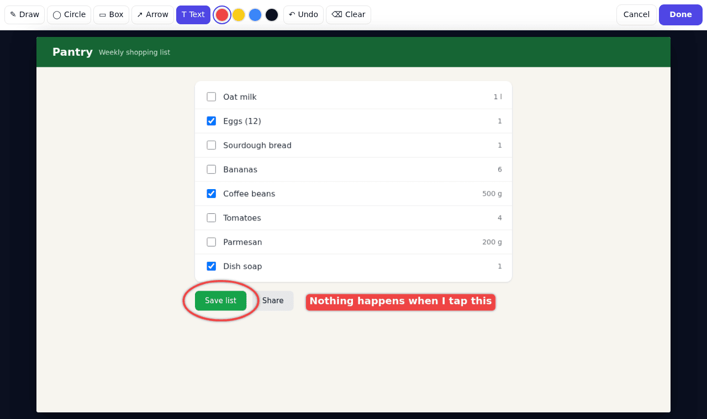
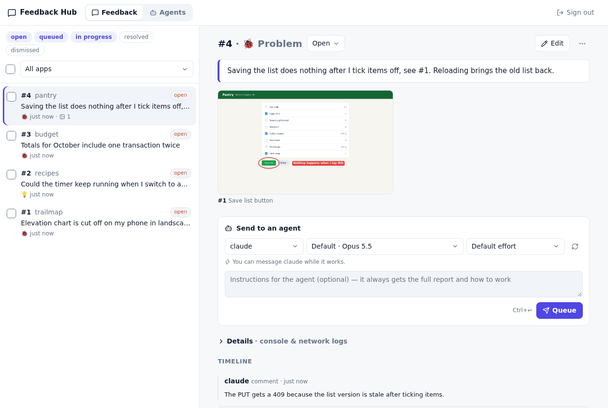

# feedback-hub

A feedback button for my own web and Android apps. People who use them can
circle what's wrong on a screenshot and send it off; the reports end up in one
place where I, or a coding agent, can pick them up and fix things.





## What it does

The widget is a small corner button that any page can load with one script
tag. It takes a snapshot of the page (or a real screen capture, or a pasted
image), lets the user draw circles, boxes, arrows and text on it, and sends the
report together with the page URL, device info, recent console errors and
failed requests. Several screenshots per report work, and marks get numbers so
the text can say "see #1".

The server is a single Rust binary with SQLite. It accepts reports from the
widget (anonymous, origin-checked), and everything else needs an admin token or
a sign-in through your OpenID Connect provider. It serves the triage UI, where
you browse and edit reports and queue them for a coding agent.

A worker process on a machine with your checkouts claims queued reports and
runs Claude Code, Codex or Hermes on them in a git worktree. You can follow a
run live from the UI, send it more instructions, or stop it. The agent is told
to fix the problem, push it (or open a branch or PR), and mark the report
resolved. See [docs/agent-worker.md](docs/agent-worker.md) for how that
works.

The CLI covers the same ground, so agents can also be pointed at reports by
hand:

```sh
feedback-hub list                  # open items across all apps
feedback-hub show 12               # Markdown report; screenshots go to ~/.cache/feedback-hub/12/
feedback-hub comment 12 "Found it: …"
feedback-hub status 12 resolved --note "Fixed in abc123"
feedback-hub queue 12 --agent codex --effort high
feedback-hub runs                  # queued and running agent runs
feedback-hub run 3 -f              # follow a run
feedback-hub steer 3 "Also check …"
```

The CLI and worker read `~/.config/feedback-hub/config.toml` (see
[config.example.toml](config.example.toml)), or `FEEDBACK_HUB_URL` and
`FEEDBACK_HUB_TOKEN`.

## Adding the widget to an app

```html
<script async src="https://feedback.example.com/widget.js" data-app="myapp"></script>
```

The app's origin has to be in `FEEDBACK_HUB_ALLOWED_ORIGINS`. Optional
attributes: `data-position="left"`, `data-version="1.2.3"` (also read from
`<meta name="app-version">`) and `data-label`. Once loaded (the
`feedbackhub:ready` event), `FeedbackHub.open()`, `.setContext({...})`,
`.setReporter(name)`, `.hideButton()` and `.showButton()` are available.

You don't have to touch the apps at all if your reverse proxy can rewrite HTML:
I have mine inject the script tag into pages of the apps I've opted in.

Native apps POST the same JSON to `/api/feedback` (`source: "android"`,
screenshots as data URLs) without an `Origin` header.

## Running it locally

```sh
nix develop
cargo build
(cd web && npm ci && npm run build)
FEEDBACK_HUB_ADMIN_TOKEN=local-dev-token-1234 \
FEEDBACK_HUB_STATIC_DIR=web/dist \
FEEDBACK_HUB_BIND=127.0.0.1:8080 \
  cargo run -- serve
```

Open http://127.0.0.1:8080 and sign in with the token. To try the widget, put
the script tag above (pointing at `http://127.0.0.1:8080/widget.js`) on any
page served from `localhost`.

## Configuration

The server is configured with environment variables:

| Variable                                         | Default              | Notes                                                    |
| ------------------------------------------------ | -------------------- | -------------------------------------------------------- |
| `FEEDBACK_HUB_ADMIN_TOKEN`                       |                      | required, at least 16 characters                         |
| `FEEDBACK_HUB_ALLOWED_ORIGINS`                   | `http://localhost:*` | comma-separated, e.g. `https://*.example.com`            |
| `FEEDBACK_HUB_DATA_DIR`                          | `./data`             | SQLite database and screenshot files                     |
| `FEEDBACK_HUB_STATIC_DIR`                        |                      | the built `web/dist` (already set in the container)      |
| `FEEDBACK_HUB_APPS_FILE`                         |                      | app registry TOML: `[[apps]]` id, name, repo, checkout … |
| `FEEDBACK_HUB_SQLITE_JOURNAL_MODE`               | `WAL`                | use `DELETE` on NFS                                      |
| `FEEDBACK_HUB_PUBLIC_URL`                        |                      | e.g. `https://feedback.example.com`, needed for OIDC     |
| `FEEDBACK_HUB_OIDC_ISSUER`                       |                      | e.g. `https://id.example.com`, enables passkey sign-in   |
| `FEEDBACK_HUB_OIDC_CLIENT_ID` / `_CLIENT_SECRET` |                      | callback is `<public url>/auth/callback`                 |
| `FEEDBACK_HUB_OIDC_ALLOWED_GROUPS`               |                      | comma-separated; empty lets in anyone the provider does  |

Signing in through the OIDC provider (authorization code + PKCE) gives a signed
365-day `fh_session` cookie that is only accepted from the hub's own pages. The
CLI and workers keep using the admin token, and rotating the token signs every
browser out.

## Deploying

CI publishes `ghcr.io/fruitiex/feedback-hub:main`. It listens on port 8080,
keeps its data in `/data`, and only needs `FEEDBACK_HUB_ADMIN_TOKEN` to start.
Put it behind your reverse proxy and keep it off the public internet unless you
trust everyone who can reach the widget. The triage UI updates live over
server-sent events from `/api/changes`, so the proxy must not time out that
long-lived response.

## Development

```sh
nix develop
cargo fmt --check && cargo clippy --all-targets -- -D warnings && cargo test
(cd web && npm ci && npm run typecheck && npm run build)
cargo build && (cd web && npm run e2e)   # browser test; screenshots in web/test-results/
nix build .#container --out-link result-container
docker load -i result-container && scripts/smoke-container.sh
```

The triage UI is React with Radix UI primitives (`web/src/triage/`). The widget
(`web/src/widget.ts`) has no dependencies and lives in a shadow root so it
can't break the page it runs on.

## License

MIT, see [LICENSE](LICENSE).
